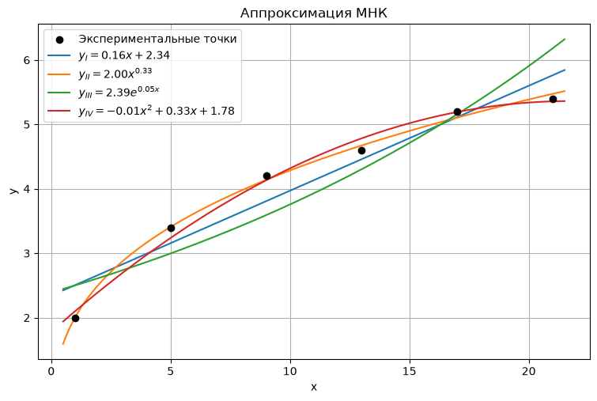

# Метод наименьших квадратов


```python
import numpy as np
import matplotlib.pyplot as plt

x = np.array([1, 5, 9, 13, 17, 21], dtype=float)
y = np.array([2.0, 3.4, 4.2, 4.6, 5.2, 5.4], dtype=float)
n = len(x)

def cramer2(A, B):
    D = np.linalg.det(A)
    D1 = np.linalg.det(np.column_stack((B, A[:, 1])))
    D2 = np.linalg.det(np.column_stack((A[:, 0], B)))
    return D1 / D, D2 / D, D, D1, D2

Sx  = x.sum()
Sy  = y.sum()
Sx2 = (x**2).sum()
Sxy = (x*y).sum()
A = np.array([[Sx2, Sx], [Sx, n]], dtype=float)
B = np.array([Sxy, Sy], dtype=float)
a_lin, b_lin, D, Da, Db = cramer2(A, B)
print("=== 1.1 Линейная ===")
print(f"Суммы: Sx={Sx}, Sy={Sy:.4f}, Sx2={Sx2}, Sxy={Sxy:.4f}")
print(f"Δ={D:.4f}, Δa={Da:.4f}, Δb={Db:.4f}")
print(f"a={a_lin:.4f}, b={b_lin:.4f}")
print(f"y = {a_lin:.2f} x + {b_lin:.2f}\n")

X = np.log(x)
Y = np.log(y)
SX  = X.sum(); SY = Y.sum(); SX2 = (X**2).sum(); SXY = (X*Y).sum()
A = np.array([[SX2, SX], [SX, n]], dtype=float)
B = np.array([SXY, SY], dtype=float)
a_pow, b_pow, D, Da, Db = cramer2(A, B)
beta_pow = np.exp(b_pow)
print("=== 1.2 Степенная ===")
print(f"Суммы: SX={SX:.4f}, SY={SY:.4f}, SX2={SX2:.4f}, SXY={SXY:.4f}")
print(f"Δ={D:.4f}, Δa={Da:.4f}, Δb={Db:.4f}")
print(f"a={a_pow:.4f}, b=ln(beta)={b_pow:.4f}, beta={beta_pow:.4f}")
print(f"y = {beta_pow:.2f} * x^{a_pow:.2f}\n")

Y = np.log(y)
Sx_  = x.sum(); Sy_ = Y.sum(); Sx2_ = (x**2).sum(); Sxy_ = (x*Y).sum()
A = np.array([[Sx2_, Sx_], [Sx_, n]], dtype=float)
B = np.array([Sxy_, Sy_], dtype=float)
a_exp, b_exp, D, Da, Db = cramer2(A, B)
beta_exp = np.exp(b_exp)
print("=== 1.3 Показательная ===")
print(f"Суммы: Sx={Sx_:.4f}, SY={Sy_:.4f}, Sx2={Sx2_:.4f}, SxY={Sxy_:.4f}")
print(f"Δ={D:.4f}, Δa={Da:.4f}, Δb={Db:.4f}")
print(f"a={a_exp:.4f}, b=ln(beta)={b_exp:.4f}, beta={beta_exp:.4f}")
print(f"y = {beta_exp:.2f} * e^({a_exp:.2f} x)\n")

Sx  = x.sum()
Sx2 = (x**2).sum()
Sx3 = (x**3).sum()
Sx4 = (x**4).sum()
Sy  = y.sum()
Sxy = (x*y).sum()
Sx2y= (x**2 * y).sum()
M = np.array([
    [Sx4,  Sx3, Sx2],
    [Sx3,  Sx2, Sx ],
    [Sx2,  Sx,  n  ]
], dtype=float)
rhs = np.array([Sx2y, Sxy, Sy], dtype=float)
Dq  = np.linalg.det(M)
Dqa = np.linalg.det(np.column_stack((rhs, M[:, 1], M[:, 2])))
Dqb = np.linalg.det(np.column_stack((M[:, 0], rhs, M[:, 2])))
Dqc = np.linalg.det(np.column_stack((M[:, 0], M[:, 1], rhs)))
a_q, b_q, c_q = Dqa/Dq, Dqb/Dq, Dqc/Dq
print("=== 1.4 Квадратичная ===")
print(f"Суммы: Sx={Sx}, Sx2={Sx2}, Sx3={Sx3}, Sx4={Sx4}, Sy={Sy:.4f}, Sxy={Sxy:.4f}, Sx2y={Sx2y:.4f}")
print(f"Δ={Dq:.4f}, Δa={Dqa:.4f}, Δb={Dqb:.4f}, Δc={Dqc:.4f}")
print(f"a={a_q:.4f}, b={b_q:.4f}, c={c_q:.4f}")
print(f"y = {a_q:.2f} x^2 + {b_q:.2f} x + {c_q:.2f}\n")

xf = np.linspace(0.5, 21.5, 400)
plt.figure(figsize=(9, 5.5))
plt.scatter(x, y, color='black', zorder=5, label='Экспериментальные точки')
plt.plot(xf, a_lin*xf + b_lin,          label=r'$y_I = %.2f x + %.2f$' % (a_lin, b_lin))
plt.plot(xf, beta_pow*xf**a_pow,        label=r'$y_{II} = %.2f x^{%.2f}$' % (beta_pow, a_pow))
plt.plot(xf, beta_exp*np.exp(a_exp*xf), label=r'$y_{III} = %.2f e^{%.2f x}$' % (beta_exp, a_exp))
plt.plot(xf, a_q*xf**2 + b_q*xf + c_q,  label=r'$y_{IV} = %.2f x^2 + %.2f x + %.2f$' % (a_q, b_q, c_q))
plt.xlabel('x'); plt.ylabel('y')
plt.title('Аппроксимация МНК')
plt.legend(); plt.grid(True)
plt.show()

def loss(f):
    return float(np.sum((f - y)**2))

yI    = a_lin*x + b_lin
yII   = beta_pow*x**a_pow
yIII  = beta_exp*np.exp(a_exp*x)
yIV   = a_q*x**2 + b_q*x + c_q

print("=== Таблица значений функций ===")
print(f"{'x':>4} {'y':>8} {'yI':>8} {'yII':>8} {'yIII':>8} {'yIV':>8}")
for i in range(n):
    print(f"{x[i]:>4.0f} {y[i]:>8.4f} {yI[i]:>8.4f} {yII[i]:>8.4f} {yIII[i]:>8.4f} {yIV[i]:>8.4f}")

print("\n=== Суммарные погрешности L ===")
print(f"L_I   = {loss(yI):.4f}")
print(f"L_II  = {loss(yII):.4f}")
print(f"L_III = {loss(yIII):.4f}")
print(f"L_IV  = {loss(yIV):.4f}")
```

    === 1.1 Линейная ===
    Суммы: Sx=66.0, Sy=24.8000, Sx2=1006.0, Sxy=318.4000
    Δ=1680.0000, Δa=273.6000, Δb=3934.4000
    a=0.1629, b=2.3419
    y = 0.16 x + 2.34
    
    === 1.2 Степенная ===
    Суммы: SX=12.2493, SY=8.2131, SX2=31.2933, SXY=18.8423
    Δ=37.7131, Δa=12.4486, Δb=26.2091
    a=0.3301, b=ln(beta)=0.6950, beta=2.0036
    y = 2.00 * x^0.33
    
    === 1.3 Показательная ===
    Суммы: Sx=66.0000, SY=8.2131, Sx2=1006.0000, SxY=103.0081
    Δ=1680.0000, Δa=75.9826, Δb=1463.8657
    a=0.0452, b=ln(beta)=0.8713, beta=2.3901
    y = 2.39 * e^(0.05 x)
    
    === 1.4 Квадратичная ===
    Суммы: Sx=66.0, Sx2=1006.0, Sx3=17226.0, Sx4=313750.0, Sy=24.8000, Sxy=318.4000, Sx2y=5088.8000
    Δ=16056320.0000, Δa=-121856.0000, Δb=5295718.4000, Δc=28544409.6000
    a=-0.0076, b=0.3298, c=1.7778
    y = -0.01 x^2 + 0.33 x + 1.78
    


    

    


    === Таблица значений функций ===
       x        y       yI      yII     yIII      yIV
       1   2.0000   2.5048   2.0036   2.5007   2.1000
       5   3.4000   3.1562   3.4083   2.9966   3.2371
       9   4.2000   3.8076   4.1381   3.5909   4.1314
      13   4.6000   4.4590   4.6721   4.3030   4.7829
      17   5.2000   5.1105   5.1047   5.1563   5.1914
      21   5.4000   5.7619   5.4735   6.1788   5.3571
    
    === Суммарные погрешности L ===
    L_I   = 0.6270
    L_II  = 0.0236
    L_III = 1.4812
    L_IV  = 0.0766


```python

```
